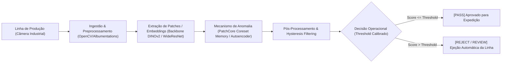
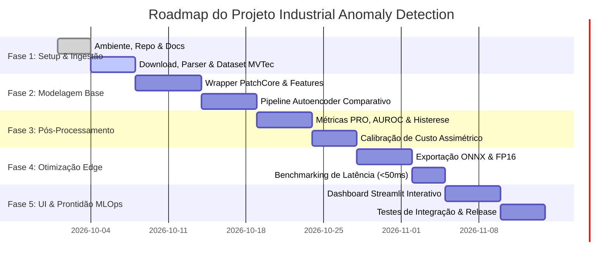

# Especificação Técnica de Projeto: Industrial Anomaly Detection
## Inspeção Visual e Detecção de Falhas Não Supervisionada em Linhas de Produção

---

### Metadados do Projeto
- **Nome do Projeto**: Industrial Anomaly Detection (IAD)
- **Status**: Fase 0 / Especificação de Arquitetura & Setup
- **Perfil Responsável**: Lead Architect & MLOps Engineer
- **Stack Tecnológico**: Python 3.10+, PyTorch, Anomalib (Lightning), Torchvision / DINOv2, OpenCV, Albumentations, Streamlit, Pytest
- **Benchmark / Dataset de Referência**: MVTec Anomaly Detection (MVTec AD)

---

## 1. Visão Geral e Objetivos do Negócio

Na manufatura moderna e controle de qualidade industrial (Quality Assurance 4.0), a ocorrência de defeitos físicos (fissuras, furos, arranhões, contaminações, desalinhamento estrutural) é intrinsecamente rara, heterogênea e imprevisível. Abordagens clássicas de classificação supervisionada falham na prática porque:
1. Requerem milhares de amostras rotuladas de cada tipo de falha concebível.
2. Defeitos inéditos (*novel defects*) que não estavam no conjunto de treino passam despercebidos.
3. A anotação em nível de pixel (*segmentation masks*) para treino é proibitivamente cara e lenta.

### Solução Arquitetural
Adota-se o paradigma **Unsupervised / Few-Shot Anomaly Detection & Localization**:
- Os modelos são treinados **exclusivamente com amostras de produtos normais/perfeitos** (`good`).
- Em tempo de inferência, qualquer desvio estatístico ou semântico em relação à distribuição aprendida de normalidade gera uma anomalia em nível de imagem (*Image-level anomaly score*) e um mapa de calor em nível de pixel (*Pixel-level anomaly segmentation map*).



---

## 2. Metas de Engenharia e KPIs de Produção

Para validar a viabilidade do sistema em ambiente industrial contínuo, estabelecemos quatro KPIs rigorosos:

| Indicador (KPI) | Meta Mínima (Baseline) | Meta Alvo (Produção SLA) | Justificativa Industrial |
| :--- | :--- | :--- | :--- |
| **Image-level AUROC** | $\ge 97.5\%$ | $\ge 99.0\%$ | Classificação binária peça boa vs. defeituosa em toda a peça. |
| **Pixel-level AUROC** | $\ge 96.0\%$ | $\ge 97.5\%$ | Precisão de localização espacial do defeito para auditoria e causa-raiz. |
| **PRO Metric (Per-Region Overlap)** | $\ge 90.0\%$ | $\ge 93.5\%$ (FPR $\le 0.30$) | Avalia cada defeito individualmente (garante que defeitos microscópicos não sejam ofuscados por defeitos grandes). |
| **Latência por Peça (P95)** | $< 80\text{ ms}$ | $< 50\text{ ms}$ | Requisito de esteira transportadora operando a $\ge 20$ peças por segundo (FPS $\ge 20$). |
| **False Negative Rate (FNR)** | $< 0.5\%$ | $< 0.1\%$ | Quase zero escape de peças defeituosas para o consumidor final. |

### Detalhamento da Métrica PRO (Per-Region Overlap)
A métrica tradicional de Pixel-AUROC sofre de distorção de área: um grande arranhão detectado compensa numericamente centenas de micro-furos não detectados. A métrica **PRO** resolve isso:
1. Cada região conexa de anomalia $C_k$ na máscara de Ground Truth é tratada como uma entidade independente.
2. Calcula-se a sobreposição relativa:
   $$\text{Overlap}(C_k, P) = \frac{|C_k \cap P|}{|C_k|}$$
   onde $P$ é a predição binarizada pelo limiar.
3. Varia-se o limiar até uma taxa máxima permitida de falsos positivos ($\text{FPR} = 0.30$) e integra-se a área sob a curva.

---

## 3. Pipeline de Dados: MVTec AD & Políticas de Augmentation

O benchmark padrão consiste em 15 categorias industriais:
- **5 Texturas Estruturadas**: `carpet`, `grid`, `leather`, `tile`, `wood`
- **10 Objetos Discretos**: `bottle`, `cable`, `capsule`, `hazelnut`, `metal_nut`, `pill`, `screw`, `toothbrush`, `transistor`, `zipper`

```text
data/mvtec_anomaly_detection/
├── <categoria>/
│   ├── train/
│   │   └── good/                  # Amostras sem defeito (exclusivo para treino)
│   ├── test/
│   │   ├── good/                  # Amostras boas para validação de falso alarme
│   │   ├── <tipo_defeito_1>/      # Ex: scratch, crack, hole, contamination
│   │   └── <tipo_defeito_n>/
│   └── ground_truth/
│       ├── <tipo_defeito_1>/      # Máscaras binárias PNG (0 = normal, 255 = defeito)
│       └── <tipo_defeito_n>/
```

### Regras Críticas do Pipeline de Dados
1. **Isolamento Estrito de Amostras**:
   - `train/good`: Usado unicamente para construir a memória de features normais ou treinar a reconstrução.
   - `test/`: Contém instâncias normais e com defeitos, com máscaras de pixel em `ground_truth/`. Nenhum vazamento (*data leakage*) é permitido.

2. **Diretriz de Data Augmentation Não-Destrutivo de Textura**:
   - **PROIBIDO**:
     - *CutOut / RandomErasing*: Cria áreas artificiais pretas que o modelo aprenderia erroneamente como normais ou geraria falsas anomalias.
     - *Ruído Gaussiano Agressivo / Salt-and-Pepper*: Destrói os micro-padrões de superfície de peças metálicas e tecidos.
     - *Jitter Severo de Cores e Contraste*: Pode camuflar oxidações, queimaduras ou contaminações sutis.
   - **PERMITIDO & RECOMENDADO**:
     - Pequenas rotações ($\pm 2^{\circ}$ a $\pm 5^{\circ}$) se a fixação mecânica da câmera tiver ligeira folga.
     - Flips horizontais/verticais **apenas** para texturas simétricas (ex: `carpet`, `leather`). Proibido para peças com orientação fixa (ex: `transistor`, `screw`).
     - Normalização padrão de ImageNet / DINOv2 via `albumentations.Normalize`.

---

## 4. Estratégia de Modelagem & Benchmark Comparativo

Comparamos duas escolas fundamentais de detecção de anomalias industriais:

```mermaid
graph TD
    subgraph Abordagem 1: PatchCore (Memória de Features)
        PC1["Imagem Normal"] --> PC2["Backbone Pré-treinado (Torchvision / DINOv2)"]
        PC2 --> PC3["Patches Locais Multi-Escala (Níveis 2 e 3)"]
        PC3 --> PC4["Coreset Subsampling (Greedy k-Center)"]
        PC4 --> PC5[("Memória Compacta M")]
        PC6["Imagem de Teste"] --> PC7["Extração de Patches"]
        PC7 --> PC8["Distância ao Vizinho Mais Próximo em M"]
        PC8 --> PC9["Heatmap Espacial & Score Máximo"]
    end

    subgraph Abordagem 2: Autoencoder (Reconstrução de Pixel)
        AE1["Imagem Normal"] --> AE2["Encoder Convolucional"]
        AE2 --> AE3["Bottleneck Latente z"]
        AE3 --> AE4["Decoder Convolucional"]
        AE4 --> AE5["Reconstrução x_hat"]
        AE5 --> AE6["Perda L1 / L2 + SSIM"]
        AE7["Imagem de Teste"] --> AE8["x - x_hat"]
        AE8 --> AE9["Mapa de Erro Residual"]
    end
```

### Análise Comparativa Detalhada

| Critério | PatchCore (Memory Bank) | Autoencoder / DFM (Reconstrução) | Vencedor / Recomendação |
| :--- | :--- | :--- | :--- |
| **Taxa de Detecção (AUROC)** | Superior ($\ge 99.1\%$ Image, $\ge 98.1\%$ Pixel) | Moderada ($\approx 88-92\%$) | **PatchCore**: captura anomalias semânticas sutis sem depender de convergência de treino. |
| **Robustez Few-Shot** | Excelente (funciona bem com 10 a 50 amostras boas) | Baixa (requer centenas de amostras para reconstruir texturas complexas) | **PatchCore** |
| **Problema do "Atalho de Identidade"** | Não sofre (usa features pré-treinadas congeladas) | Frequente (redes convolucionais tendem a reconstruir defeitos pequenos com sucesso) | **PatchCore** |
| **Pegada de Memória em RAM** | Moderada a Alta (reduzida via Coreset Subsampling 1% a 10%) | Muito Baixa (apenas os pesos da rede) | **Autoencoder** (para microcontroladores muito limitados) |
| **Latência de Inferência** | 15–35 ms em GPU / 40–80 ms em CPU (com FAISS/ONNX) | 10–25 ms | **Empate Técnico** (PatchCore atinge meta <50ms com Coreset 10% e FP16). |

### Estratégia de Backbones: Torchvision vs. DINOv2
1. **Torchvision WideResNet-50-2 / ResNet-18**:
   - Baseline industrial padrão do artigo original PatchCore (Roth et al., 2022).
   - Excelente sensibilidade para texturas geométricas e micro-defeitos de borda.
2. **Meta DINOv2 (ViT-S/14 ou ViT-B/14)**:
   - Pré-treinado via auto-supervisão em 142M de imagens sem viés de classes fechadas.
   - Produz representações semânticas e localizadas de altíssima fidelidade para objetos complexos (`transistor`, `capsule`, `zipper`).

---

## 5. Calibração de Threshold Operacional & Custo de Erro

Em linhas de produção, a matriz de custos de erro é fortemente assimétrica:

$$\text{Custo}(FN) \gg \text{Custo}(FP)$$

- **Falso Negativo ($FN$)**: Peça defeituosa é classificada como boa e segue para a montagem automotiva ou aeroespacial.
  - *Consequência*: Recall de produto, quebra em operação, multas contratuais, dano severo à marca ($\ge \$10.000$ por evento).
- **Falso Positivo ($FP$)**: Peça perfeita é classificada como defeituosa.
  - *Consequência*: Reinspeção manual humana rápida ou descarte de baixo valor ($\approx \$0,20 - \$2,00$).

### Formulação do Limiar de Custo Mínimo
Em vez de calibrar o limiar $\tau$ puramente pelo F1-Score simétrico tradicional ($\beta=1$):

$$\tau^*_{\text{custo}} = \arg\min_\tau \left[ C_{FN} \cdot FN(\tau) + C_{FP} \cdot FP(\tau) \right]$$

Na prática operacional:
1. **Constraint de Segurança**: Fixamos a sensibilidade mínima permitida $\text{Recall} \ge 99.5\%$.
2. Encontra-se o maior threshold $\tau$ que satisfaz essa restrição, minimizando o descarte falso ($FP$).
3. **Thresholding por Histerese (Dual-Threshold)**:
   - $\tau_{\text{high}}$: Confirmação definitiva de defeito estrutural.
   - $\tau_{\text{low}}$: Gatilho de alerta para inspeção secundária ou ativação de área de suspeita morfológica.
4. **Filtros Morfológicos de Pós-Processamento**:
   - Aplicação de abertura morfológica (*Opening*, kernel $3 \times 3$) para aniquilar ruídos espúrios de sensor CCD/CMOS.
   - Aplicação de fechamento morfológico (*Closing*, kernel $5 \times 5$) para unir fragmentos de um mesmo risco contínuo.

---

## 6. Roadmap de Fases e Critérios de Aceitação



### Detalhamento dos Critérios de Aceitação por Fase

#### Fase 1: Fundação do Repositório & Ingestão de Dados
- **Entrega**:
  - Estrutura completa de pastas criada (`configs/`, `data/`, `src/`, `ui/`, `tests/`).
  - Módulo `src/dataset/mvtec.py` com download automático, parsing de classes, validação de integridade e PyTorch Dataset.
- **Critério de Aceitação**: Testes unitários de dataset executam sem erros; download e parsing de `bottle` ou `screw` validam 100% dos pares imagem/máscara.

#### Fase 2: Core Modeling (PatchCore & Benchmark)
- **Entrega**:
  - `src/models/patchcore_wrapper.py` integrando extração de features, coreset subsampling e cálculo de distâncias.
  - Arquivos de configuração YAML estruturados em `configs/`.
- **Critério de Aceitação**: Image-AUROC $\ge 98.0\%$ e Pixel-AUROC $\ge 96.5\%$ na categoria `bottle`.

#### Fase 3: Pós-Processamento, PRO Metric & Calibração
- **Entrega**:
  - `src/postprocessing/postprocessor.py` (normalização, histerese, abertura/fechamento morfológico, contornos e heatmaps).
  - `src/utils/metrics.py` com implementação vetorizada de PRO metric e cálculo de threshold ótimo por custo.
- **Critério de Aceitação**: PRO metric calculada com sucesso em $\le 10$ segundos por categoria; teste de histerese comprova redução de falsos positivos isolados em $> 80\%$.

#### Fase 4: Otimização para Edge e Latência de Produção
- **Entrega**:
  - Pipeline de inferência com suporte a GPU/CPU com quantização FP16 ou exportação ONNX Runtime.
  - Script de benchmark de latência por peça sob carga contínua.
- **Critério de Aceitação**: Latência P95 $< 50\text{ ms}$ em GPU moderada (RTX 3060 / T4) e $< 120\text{ ms}$ em CPU Intel i7/Xeon para resolução $256 \times 256$.

#### Fase 5: Streamlit QA Dashboard & Prontidão MLOps
- **Entrega**:
  - Aplicação interativa em `ui/app.py` com seleção de categorias MVTec, ajuste em tempo real de threshold, sliders de custo $C_{FN}/C_{FP}$, visualização de heatmaps térmicos (OpenCV Jet/Turbo) e tabela de métricas.
- **Critério de Aceitação**: Operador ou engenheiro de controle de qualidade consegue carregar uma imagem nova, inspecionar a máscara de anomalia e obter o veredito PASS/FAIL em interface web fluida.

---

## 7. Governança e Melhores Práticas de Engenharia
- **Versionamento**: Commits semânticos no Git (`feat:`, `fix:`, `docs:`, `test:`, `refactor:`).
- **Testes Automatizados**: Cobertura de testes unitários $\ge 80\%$ via `pytest` para componentes críticos de dados, métricas e pós-processamento.
- **Tipagem Estática**: Código em conformidade com PEP 484 (type hints em todas as assinaturas de funções e classes).
- **Reprodutibilidade**: Sementes determinísticas (`torch.manual_seed(42)`, `numpy.random.seed(42)`) configuráveis via YAML.

