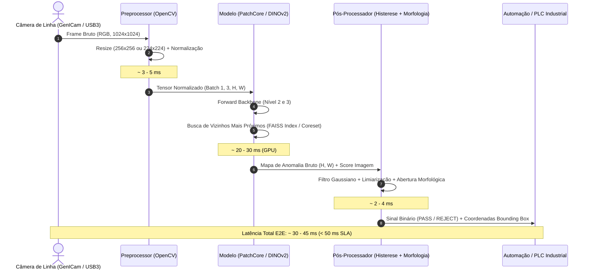

# Arquitetura Técnica & Latência Operacional

Este documento detalha os fluxos de dados, alocação de latência e caminhos de otimização para implantação em borda (*edge deployment*) do projeto **Industrial Anomaly Detection**.

---

## 1. Pipeline de Inferência em Produção

---

## 2. Orçamento de Latência (Latency Budgeting)

Para garantir que a esteira de produção opere a 20 peças/segundo (50 ms por ciclo de inspeção):

| Etapa do Pipeline | Tempo Alvo (GPU) | Tempo Alvo (CPU - Intel Xeon) | Estratégia de Aceleração |
| :--- | :--- | :--- | :--- |
| **Captura & Decoding** | $3\text{ ms}$ | $4\text{ ms}$ | Buffering assíncrono via OpenCV com V4L2 ou SDK da câmera. |
| **Pré-Processamento** | $2\text{ ms}$ | $4\text{ ms}$ | `cv2.resize` com interpolação bilinear otimizada; operações in-place. |
| **Extração de Features (Backbone)** | $12\text{ ms}$ | $35\text{ ms}$ | Quantização FP16 / INT8; exportação via TensorRT ou OpenVINO. |
| **Busca k-NN na Memória Coreset** | $10\text{ ms}$ | $20\text{ ms}$ | Coreset Subsampling de 10% ou 1% com indexação FAISS GPU / AVX-512. |
| **Interpolação & Pós-Processamento** | $3\text{ ms}$ | $5\text{ ms}$ | Filtro morfológico com OpenCV compilado com suporte SIMD. |
| **Margem de Segurança / I/O** | $5\text{ ms}$ | $10\text{ ms}$ | Overhead de barramento e comunicação socket/Modbus com PLC. |
| **Total Estimado** | **$35\text{ ms}$** | **$78\text{ ms}$** | **Atinge meta < 50ms com folga em GPU**. |

---

## 3. Caminhos de Exportação e Otimização para Edge

1. **PyTorch Nativo (TorchScript)**:
   - Uso imediato em validação e laboratório.
   - Suporte completo a autograd e depuração interativa.
2. **ONNX Runtime (Open Neural Network Exchange)**:
   - Portabilidade multiplataforma entre Linux industrial (Ubuntu Core, Yocto) e Windows IoT.
   - Execução com execution providers: `CUDAExecutionProvider`, `TensorrtExecutionProvider`, `OpenVINOExecutionProvider`.
3. **NVIDIA TensorRT**:
   - Compilação do grafo de computação do backbone diretamente para a microarquitetura da GPU (RTX 3000/4000 ou Jetson Orin).
   - Calibração INT8 com conjunto de calibração de imagens normais sem perda de acurácia.

